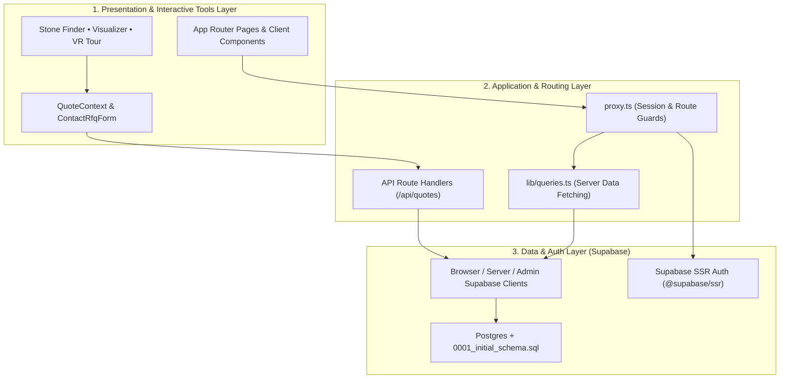

# Maadi Website — B2B/B2C Stone & Marble Manufacturing Platform

An enterprise-ready Next.js 16 and Supabase web platform for natural stone and marble manufacturing, combining an interactive product showcase, architectural visualization tools, a Request-for-Quote (RFQ) workflow, and a role-based administrative portal.

---

## 1. Executive Summary & Purpose
`maadi-website` digitizes the end-to-end customer journey for a stone and marble manufacturer. Prospective architects, contractors, and homeowners can explore curated stone catalogs, test materials inside interactive tools (Stone Finder, Visualizer, and VR Tour), save project favorites, and submit structured RFQs (`/request-price`, `/api/quotes`). Internally, staff use `/admin` to manage stone inventory, content, quote pipelines, and user access.

---

## 2. System Architecture & Layers



| Layer | Responsibility | Key Files |
| :--- | :--- | :--- |
| **Presentation Layer** | Responsive UI, scroll animations (`Reveal`, `AnimatedCounter`), interactive stone filtering, and client state | `components/HomeClient.tsx`, `StonesCatalogClient.tsx`, `StoneDetailClient.tsx`, `ManufacturingClient.tsx`, `QuoteContext.tsx` |
| **Interactive Tools Layer** | Pre-purchase decision tools reducing buyer friction | `app/tools/stone-finder/page.tsx`, `app/tools/visualizer/page.tsx`, `app/tools/vr-tour/page.tsx` |
| **Routing & Security Layer** | SSR session propagation and admin route isolation | `proxy.ts`, `app/admin/layout.tsx` |
| **API & Query Layer** | Quote submission endpoint and typed data access | `app/api/quotes/route.ts`, `lib/queries.ts`, `lib/types.ts`, `lib/stones-data.ts` |
| **Persistence & Auth Layer** | Browser, SSR server, and elevated service-role Supabase clients backed by SQL migrations | `lib/supabase/{client,server,admin}.ts`, `supabase/migrations/0001_initial_schema.sql` |

---

## 3. Core Functionality & Modules

### Customer-Facing Storefront
- **Stone Catalog (`/stones`, `/stones/[slug]`)**: Browse marble and natural stone varieties with rich detail views, technical specs, and favorites toggling (`/favorites`).
- **Interactive Decision Tools (`/tools/*`)**:
  - **Stone Finder (`/tools/stone-finder`)**: Guided selection based on project needs.
  - **Visualizer (`/tools/visualizer`)**: Preview stone finishes in architectural contexts.
  - **VR Tour (`/tools/vr-tour`)**: Virtual showroom / quarry / factory walkthrough.
- **Manufacturing & Credibility (`/manufacturing`, `/projects`, `/our-story`, `/academy`, `/resources`)**: Showcase production lines, completed landmark projects, and educational guides.
- **RFQ & Lead Capture (`/request-price`, `/contact`)**: Structured quote requests persisted via `/api/quotes`.
- **Customer Portal (`/sign-in`, `/account`)**: Authenticated user access to saved favorites and account details.

### Administrative Suite (`/admin`)
- **Overview (`/admin`)**: Centralized admin shell (`AdminShell.tsx`).
- **Stone Catalog Management (`/admin/stones`)**: Create, update, and organize stone listings.
- **Quote Pipeline (`/admin/quotes`)**: Review and process incoming customer RFQs.
- **CMS & Users (`/admin/content`, `/admin/users`)**: Manage site content and user permissions.

---

## 4. Project Structure
```text
├── app/
│   ├── academy/            # Stone education & academy
│   ├── account/            # Customer profile
│   ├── admin/              # Admin portal (content, quotes, stones, users)
│   ├── api/quotes/         # Quote submission REST endpoint
│   ├── contact/            # Contact & RFQ intake
│   ├── favorites/          # Saved stone shortlist
│   ├── legal/              # Legal & compliance pages
│   ├── manufacturing/      # Factory & production capabilities
│   ├── our-story/          # Brand heritage
│   ├── projects/           # Architectural portfolio
│   ├── request-price/      # Dedicated pricing request flow
│   ├── resources/          # Downloadable/technical resources
│   ├── sign-in/            # Supabase Auth login
│   ├── stones/             # Catalog & [slug] dynamic detail pages
│   └── tools/              # stone-finder, visualizer, vr-tour
├── components/             # Client UI, headers, footers, RFQ & quote context
├── lib/                    # Supabase clients, typed queries, seed data
├── supabase/migrations/    # Initial Postgres schema
├── tests/                  # Automated test suite
└── proxy.ts                # Request/auth middleware
```

---

## 5. Getting Started

### Prerequisites
- Node.js 20+ and npm
- A Supabase project

### Setup & Environment Variables
```bash
git clone https://github.com/islamsamyy/maadi-website.git
cd maadi-website
npm install
cp .env.example .env.local
```

Configure `.env.local`:
```env
NEXT_PUBLIC_SUPABASE_URL=https://your-project-ref.supabase.co
NEXT_PUBLIC_SUPABASE_ANON_KEY=your-anon-key
SUPABASE_SERVICE_ROLE_KEY=your-service-role-key
```

### Scripts
| Command | Description |
| :--- | :--- |
| `npm run dev` | Start Next.js 16 dev server |
| `npm run build` | Build production bundle |
| `npm run start` | Run production server |
| `npm run lint` | Run ESLint 9 checks |

---

## 6. Business Value & Growth Opportunities
- **Higher RFQ Conversion via Interactive Tools**: The Stone Finder, Visualizer, and VR Tour qualify buyers before they speak to sales, shortening B2B/B2C sales cycles.
- **B2B Contractor & Architect Portal**: Extend `/account` and `/favorites` into project spec sheets (PDF export) and tiered wholesale pricing for repeat contractors.
- **ERP Integration**: Connect `/api/quotes` directly to factory inventory/production platforms (e.g., `wirecut-`) to provide real-time slab availability and lead-time estimates.
- **Automated Follow-Up & CRM**: Trigger transactional emails/WhatsApp notifications upon quote submission and status updates in `/admin/quotes`.
- **SEO & International Expansion**: Add multi-locale support (Arabic/English) and structured schema markup on `/stones/[slug]` to capture regional export leads.
