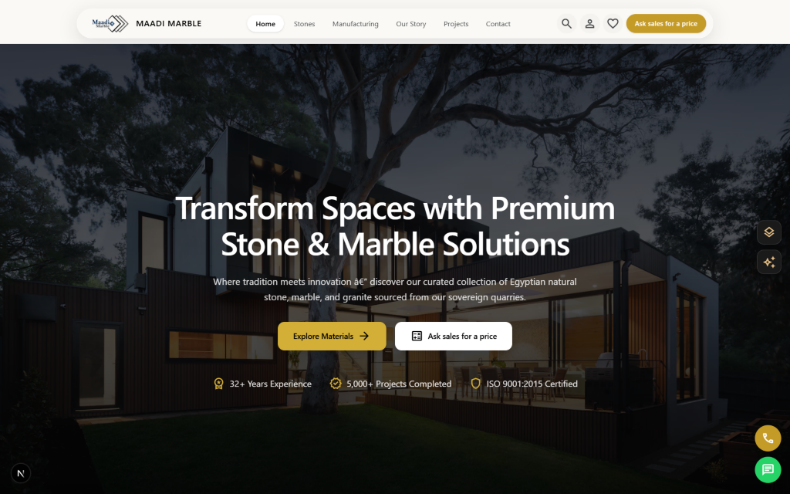
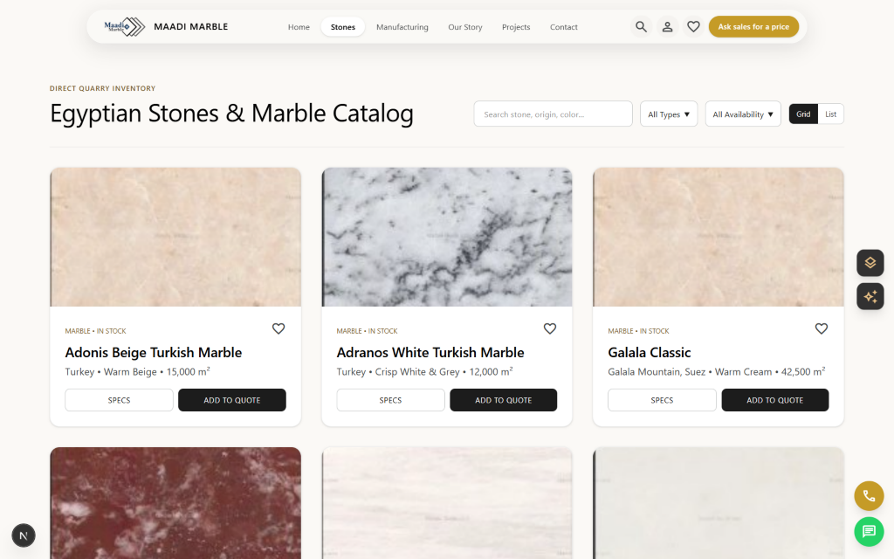
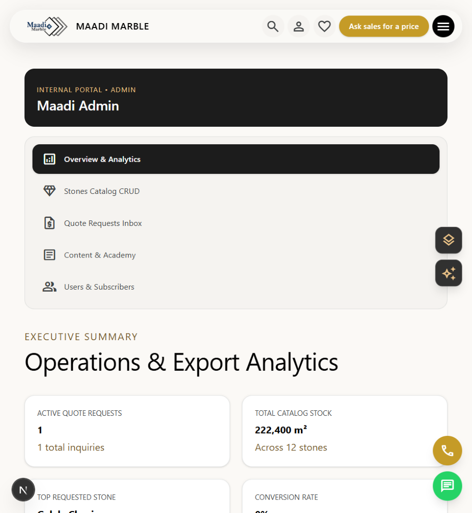

# Maadi Marble — Natural Stone & Marble Export Platform

A modern B2B/B2C natural stone catalog, smart visualization suite, and consolidated **Request-for-Quotation (RFQ)**

---

## Documentation & Commercial Proposal

- **[Architecture, Business Logic & Full-System Screenshots](docs/ARCHITECTURE_AND_BUSINESS_LOGIC.md)** — Complete technical architecture, Supabase RLS schema, RFQ pipeline, route map, and 9 full-system screenshots.
- **[Commercial & Financial Proposal (العرض التجاري والمالي)](docs/COMMERCIAL_PROPOSAL.md)** — Bilingual (EN/AR) business value, ROI breakdown, development scope, cloud operating costs, and payment milestones.

---

## System Preview



| Catalog & Technical Datasheet | Admin Operations & Analytics |
| :---: | :---: |
|  |  |

---

## Key Features

- **Dynamic Stone Catalog (`/stones`, `/stones/[slug]`):** Filter by stone type, category, and availability; inspect density, water absorption, slab sizes, finishes, thicknesses, and live `m²` stock.
- **Quote Basket & Consolidated RFQ (`/request-price`, `/api/quotes`):** Persistent client basket + favorites synced with Supabase, generating traceable `QT-YYYY-XXX-XXX` quote codes.
- **Smart Selection Tools:** AI Stone Finder (`/tools/stone-finder`), Interactive Room Visualizer (`/tools/visualizer`), and VR Warehouse Tour (`/tools/vr-tour`).
- **Stone Academy & Technical Dossiers (`/academy`, `/resources`):** Educational guides and CAD/BIM specifications.
- **Role-Based Portals (`/account`, `/admin`):** Trade account RFQ tracking for customers, and executive KPIs, Quote Inbox, Catalog, Content, and User Role management for `sales` and `admin` staff.

---


4. **Start the development server:**
   ```bash
   npm run dev
   ```
