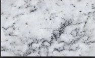
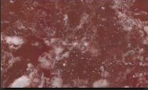
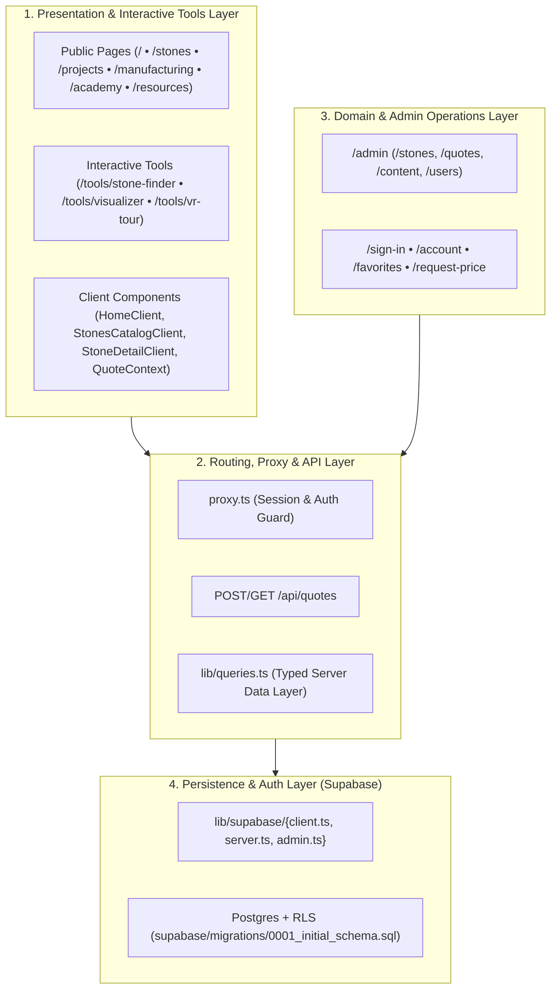
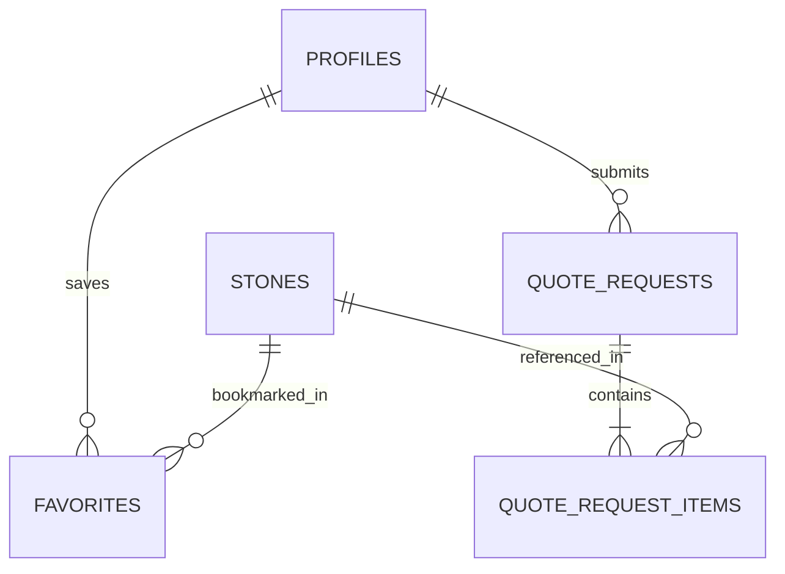

# Maadi Website — B2B/B2C Stone & Marble Manufacturing Platform

<p align="center">
  
</p>

## Table of Contents
- [Executive Summary & Business Utility](#executive-summary--business-utility)
- [Visual Showcase (UI & Dashboards)](#visual-showcase-ui--dashboards)
- [System Architecture & Layers](#system-architecture--layers)
- [Data Model & Analytics](#data-model--analytics)
- [Database Schema, Migrations & RLS](#database-schema-migrations--rls)
- [Application Modules & API Endpoints](#application-modules--api-endpoints)
- [Getting Started & Scripts](#getting-started--scripts)
- [Business Value, ROI & Growth Opportunities](#business-value-roi--growth-opportunities)

---

## Executive Summary & Business Utility
`maadi-website` is a full-stack Next.js 16 and Supabase digital commerce and lead-generation platform engineered for **Maadi Stone & Marble Manufacturing**. It bridges the gap between raw quarry/factory supply and architects, interior designers, contractors, and homeowners by combining a searchable natural stone catalog, interactive visualization tools (Stone Finder, Architectural Visualizer, VR Tour), an educational Academy, and an end-to-end Request-for-Quote (RFQ) pipeline backed by a role-gated `/admin` portal.

---

## Visual Showcase (UI & Dashboards)
Real stone catalog assets served from `public/stones/` and rendered across `/stones`, `/stones/[slug]`, and `/tools/*`:

| Adonis Beige Turkish Marble | Adranos White Turkish Marble | Aegean Bordeaux Turkish Marble |
| :---: | :---: | :---: |
|  |  |  |

| Aegean White Greek Marble | Afyon White Turkish Marble | Agia Marina Clouded Semi-White |
| :---: | :---: | :---: |
|  |  |  |

---

## System Architecture & Layers



| Layer | Responsibility | Key Files |
| :--- | :--- | :--- |
| **Presentation & Interactive Layer** | Responsive storefront, animated counters (`AnimatedCounter`), scroll reveals (`Reveal`), quote cart state (`QuoteContext`), and 3 interactive buyer tools | `components/*.tsx`, `app/tools/{stone-finder,visualizer,vr-tour}/page.tsx` |
| **Routing & Security Layer** | Request proxy, SSR cookie forwarding, and admin layout guard | `proxy.ts`, `app/admin/layout.tsx` |
| **API & Query Layer** | RFQ ingestion (`app/api/quotes/route.ts`), typed queries (`lib/queries.ts`), static fallback seed (`lib/stones-data.ts`) | `app/api/quotes/route.ts`, `lib/{queries,stones-data,types}.ts` |
| **Data & Auth Layer** | Browser, SSR, and service-role Supabase clients with PostgreSQL schema & RLS | `lib/supabase/{client,server,admin}.ts`, `supabase/migrations/0001_initial_schema.sql` |

---

## Data Model & Analytics
The platform models natural stone varieties, architectural case studies, educational articles, customer wishlists, and multi-item RFQ submissions (`quote_requests` + `quote_request_items`) alongside newsletter subscribers.



---

## Database Schema, Migrations & RLS
Defined in `supabase/migrations/0001_initial_schema.sql`:

| Table | Purpose |
| :--- | :--- |
| `public.profiles` | Authenticated customer and admin user profiles & roles |
| `public.stones` | Natural stone & marble catalog (slug, origin, finish, specs, imagery) |
| `public.projects` | Completed architectural & commercial installations |
| `public.academy_articles` | Technical stone-care, specification, and industry articles |
| `public.favorites` | User-saved stone shortlists linked to `profiles` and `stones` |
| `public.quote_requests` | Customer RFQ headers (contact info, project scope, status) |
| `public.quote_request_items` | Line items linking requested `stones` and quantities to `quote_requests` |
| `public.newsletter_subscribers` | Marketing & catalog update subscribers |

---

## Application Modules & API Endpoints

### Public & Customer Routes
- `/` (`app/page.tsx`) — Brand landing with `HomeClient` & `HomeInteractiveSections`
- `/stones` & `/stones/[slug]` — Filterable stone catalog (`StonesCatalogClient`) & detail specs (`StoneDetailClient`)
- `/tools/stone-finder`, `/tools/visualizer`, `/tools/vr-tour` — Interactive material selection & virtual tour
- `/manufacturing`, `/projects`, `/our-story`, `/academy`, `/resources`, `/legal` — Authority & trust pages
- `/request-price`, `/contact`, `/favorites`, `/account`, `/sign-in` — RFQ submission & customer portal

### Admin Portal (`/admin`)
- `/admin` — Admin overview (`AdminShell.tsx`)
- `/admin/stones` — Catalog CRUD
- `/admin/quotes` — Incoming RFQ triage & pricing workflow
- `/admin/content` — Projects & academy CMS
- `/admin/users` — Role & account management

### API Endpoints
| Endpoint | Purpose |
| :--- | :--- |
| `/api/quotes` (`app/api/quotes/route.ts`) | Validates and persists incoming customer RFQ requests and line items |

---

## Getting Started & Scripts

```bash
git clone https://github.com/islamsamyy/maadi-website.git
cd maadi-website
npm install
cp .env.example .env.local
```

**Environment Variables (`.env.example`)**:
```env
NEXT_PUBLIC_SUPABASE_URL=https://your-project-ref.supabase.co
NEXT_PUBLIC_SUPABASE_ANON_KEY=your-anon-key
SUPABASE_SERVICE_ROLE_KEY=your-service-role-key
```

| Script | Command | Description |
| :--- | :--- | :--- |
| Dev | `npm run dev` | Start Next.js 16 development server |
| Build | `npm run build` | Production build |
| Start | `npm run start` | Serve production build |
| Lint | `npm run lint` | Run ESLint 9 checks |

---

## Business Value, ROI & Growth Opportunities
- **Pre-Qualified B2B Lead Engine**: The combination of `/tools/stone-finder`, `/tools/visualizer`, and `QuoteContext` educates architects and contractors before they submit `/request-price`, cutting sales engineering back-and-forth.
- **Factory-to-Storefront Sync**: Connect `public.stones` and `public.quote_requests` directly to `wirecut-` production/inventory logs to display live slab stock (m²) and factory lead times.
- **B2B Trade Portal**: Add tiered wholesale pricing, instant PDF spec-sheet generation, and sample-box ordering via Stripe/Moyasar.
- **Multilingual Export Expansion**: Add Arabic/French/Italian localization on `/stones/[slug]` to capture international stone import buyers.
