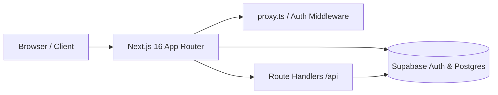

# Maadi Website — Stone & Marble Manufacturing Platform

A full-stack Next.js and Supabase web application for showcasing natural stone and marble catalogs, manufacturing capabilities, architectural projects, academy resources, and quote requests, backed by a role-based admin portal.

## Executive Summary & Purpose
`maadi-website` serves as the digital storefront and B2B/B2C inquiry platform for a stone and marble manufacturing business. Customers can browse stone collections, save favorites, explore completed projects and manufacturing processes, and submit pricing requests. Administrators manage stone inventory, incoming quotes, site content, and user accounts through a dedicated `/admin` dashboard.

## Core Functionality & Features
- **Public Catalog & Showcase**:
  - **Stones (`/stones`)**: Browse stone and marble varieties with filtering and detail views.
  - **Projects (`/projects`) & Manufacturing (`/manufacturing`)**: Showcase completed installations and production capabilities.
  - **Academy (`/academy`) & Resources (`/resources`)**: Educational guides and technical documentation.
  - **Our Story (`/our-story`) & Contact (`/contact`)**: Company background and direct inquiry channels.
- **Customer Portal**:
  - **Authentication (`/sign-in`)**: Email/session authentication powered by `@supabase/ssr`.
  - **Favorites (`/favorites`) & Account (`/account`)**: Save preferred stones and manage profile details.
  - **Quote Requests (`/request-price`)**: Submit project-specific pricing inquiries.
- **Admin Dashboard (`/admin`)**:
  - Manage **Stones** (`/admin/stones`), **Quotes** (`/admin/quotes`), **Content** (`/admin/content`), and **Users** (`/admin/users`).

## Architecture & Tech Stack
- **Framework**: Next.js 16 (`16.4.6`) with App Router & React 19 (`19.3.0`)
- **Language**: TypeScript 5
- **Styling**: Tailwind CSS 4 (`@tailwindcss/turbopack`)
- **Backend & Auth**: Supabase (`@supabase/supabase-js`, `@supabase/ssr`)
- **Linting**: ESLint 9 (`eslint-config-next`)



## Project Structure
```text
├── app/
│   ├── academy/          # Educational resources
│   ├── account/          # User profile & settings
│   ├── admin/            # Admin dashboard (content, quotes, stones, users)
│   ├── api/              # Backend API route handlers
│   ├── contact/          # Contact page
│   ├── favorites/        # Saved stones
│   ├── legal/            # Legal & policy pages
│   ├── manufacturing/    # Manufacturing capabilities
│   ├── our-story/        # Company story
│   ├── projects/         # Project portfolio
│   ├── request-price/    # Quote request form
│   ├── resources/        # Technical resources
│   ├── sign-in/          # Authentication page
│   ├── stones/           # Stone catalog
│   └── tools/            # Utility tools
├── components/           # Reusable UI components
├── lib/                  # Supabase clients & shared utilities
├── supabase/             # Database migrations / config
├── tests/                # Test suite
└── proxy.ts              # Request proxy / session handling
```

## Getting Started

### Prerequisites
- Node.js 20+
- npm
- A Supabase project

### Installation & Setup
```bash
git clone https://github.com/islamsamyy/maadi-website.git
cd maadi-website
npm install
```

Copy `.env.example` to `.env.local` and configure your Supabase credentials:
```bash
cp .env.example .env.local
```

### Available Scripts
| Command | Description |
| :--- | :--- |
| `npm run dev` | Start the Next.js development server |
| `npm run build` | Build the production bundle |
| `npm run start` | Start the production server |
| `npm run lint` | Run ESLint checks |
