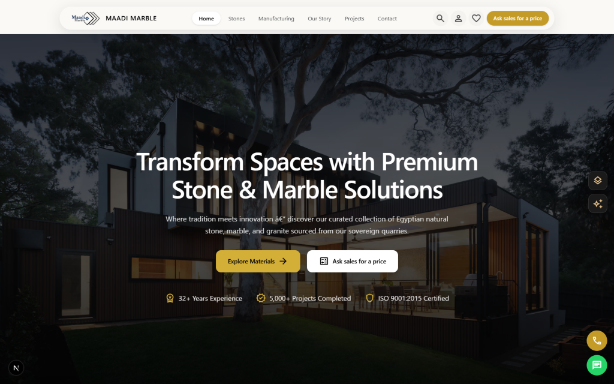
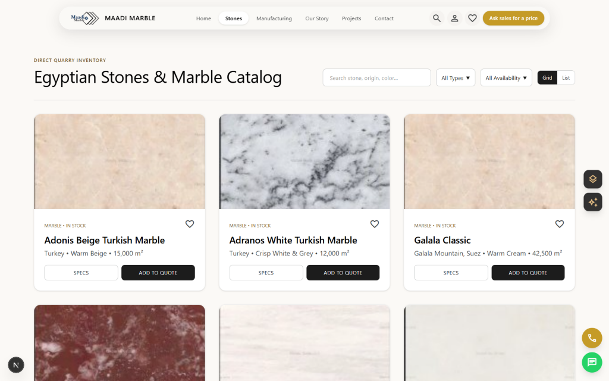
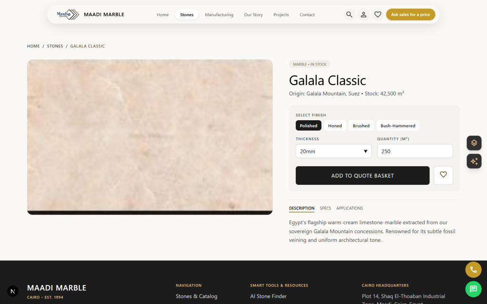
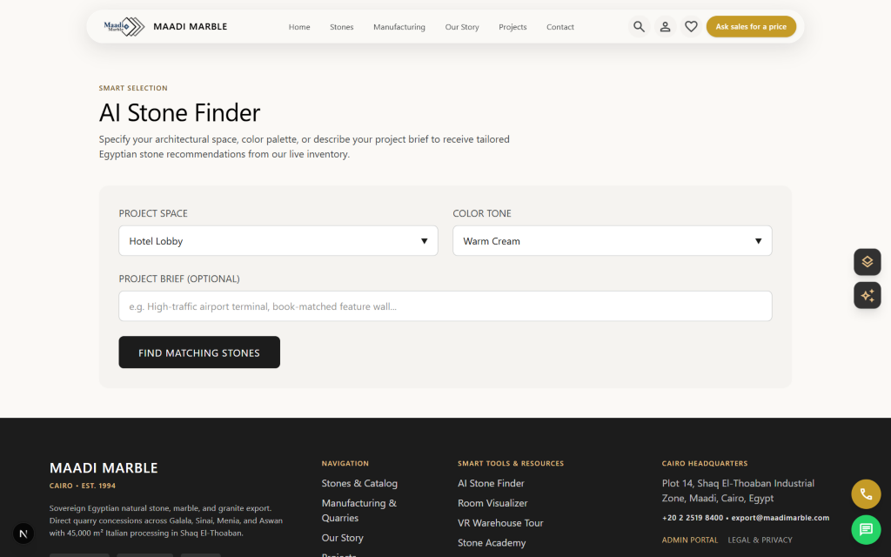
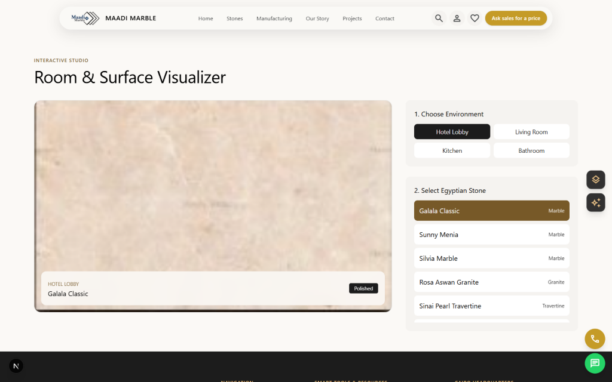
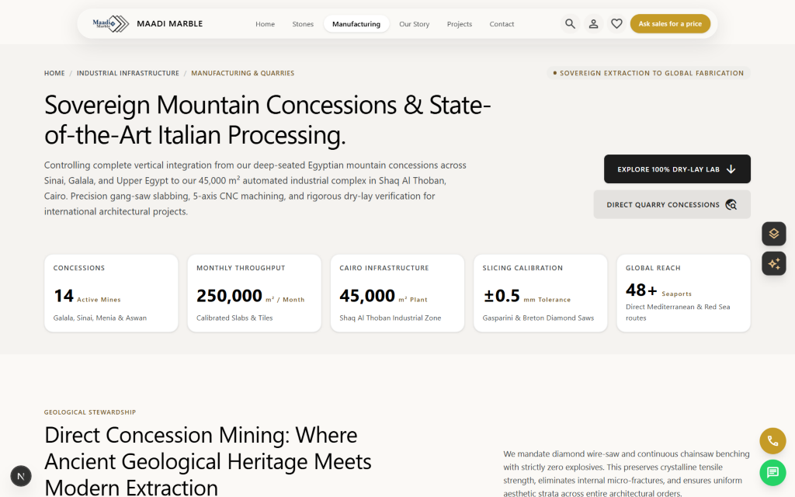
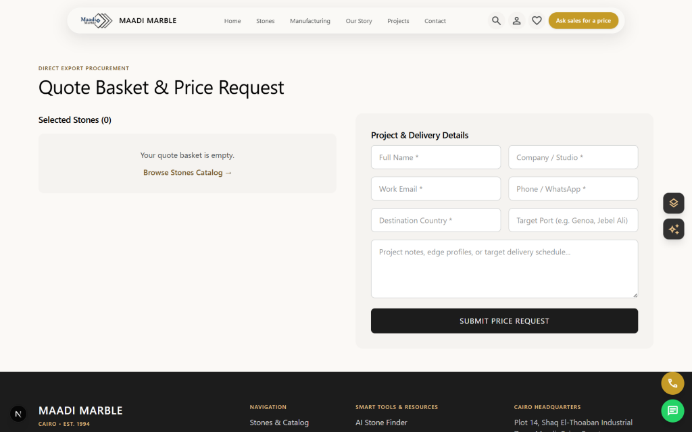
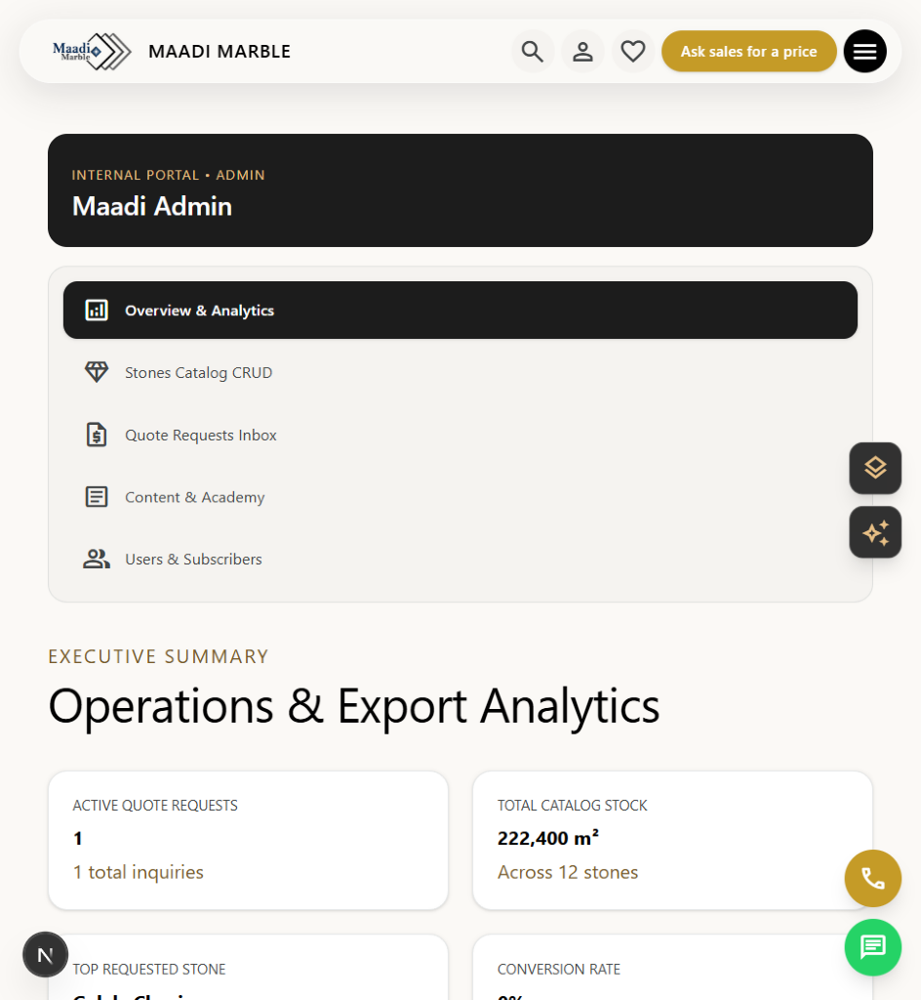
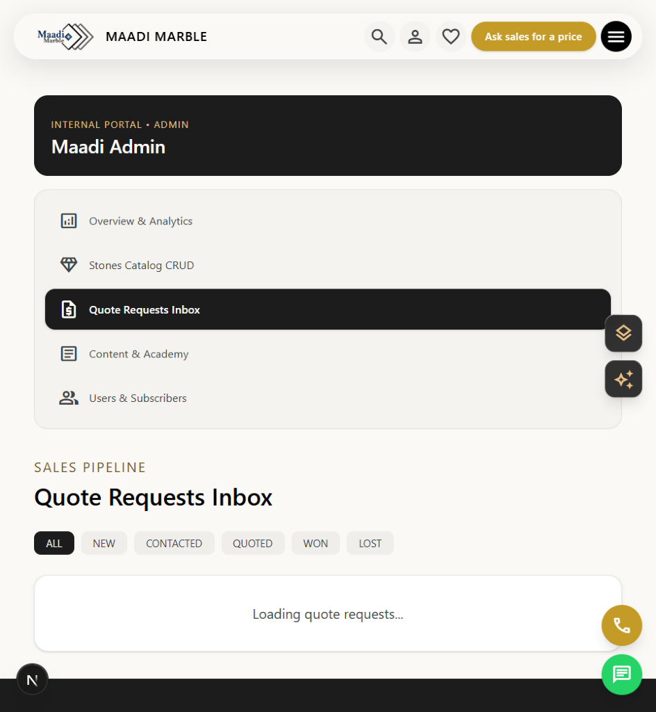

# Maadi Marble — Technical Documentation & Business Logic

> **Platform:** Natural Stone, Marble & Granite Export Catalog + B2B/B2C Quote (RFQ) Platform  
> **Stack:** Next.js 16.4.6 (App Router, Turbopack), React 19, TypeScript, Tailwind CSS v4, Supabase (PostgreSQL, Auth, Row-Level Security)

---

## 1. System Architecture

Maadi Marble is a **catalog-first lead-generation and export procurement platform**—not a traditional e-commerce checkout store. International buyers, architects, and contractors browse live slab inventory, test stones in interactive smart tools, save favorites, assemble a multi-stone **Quote Basket**, and submit a single consolidated **Request for Quotation (RFQ)** to the export sales team.

```
┌─────────────────────────────────────────────────────────────────────────┐
│                         CLIENT BROWSER (Next.js)                        │
│  • Public Catalog & Stone Details   • QuoteContext (localStorage + DB)  │
│  • AI Stone Finder & Room Visualizer • Sign-In / Trade Account Portal   │
└───────────────────────────────┬─────────────────────────────────────────┘
                                │ HTTPS / SSR Cookies (@supabase/ssr)
┌───────────────────────────────▼─────────────────────────────────────────┐
│                    NEXT.JS 16 APP ROUTER & PROXY                        │
│  • Server Components (lib/queries.ts)                                   │
│  • proxy.ts (Session refresh & /account, /admin route guard)            │
│  • API Route: POST /api/quotes (RFQ & line-item persistence)            │
└───────────────────────────────┬─────────────────────────────────────────┘
                                │
┌───────────────────────────────▼─────────────────────────────────────────┐
│                     SUPABASE (PostgreSQL + Auth)                        │
│  • auth.users + trigger private.handle_new_user() → public.profiles     │
│  • Row-Level Security (RLS) via private.get_my_role()                   │
│  • Tables: stones, projects, academy_articles, favorites,               │
│            quote_requests, quote_request_items                          │
└─────────────────────────────────────────────────────────────────────────┘
```

---

## 2. Database Schema & Security (RLS)

Defined in [`supabase/migrations/0001_initial_schema.sql`](../supabase/migrations/0001_initial_schema.sql):

| Table | Purpose | Key Constraints / RLS Rules |
| :--- | :--- | :--- |
| `public.profiles` | User profile & RBAC role | Roles: `customer` (default), `sales`, `admin`. Users can read/update own profile without escalating `role`. Staff (`admin`, `sales`) can read all profiles; only `admin` can change roles. |
| `public.stones` | Natural stone catalog | Types: `Marble`, `Granite`, `Travertine`, `Limestone`, `Onyx`. Public reads `published = true`; `admin`/`sales` can insert/update; `admin` can delete. |
| `public.projects` | Architectural case studies | Public reads `published = true`; `admin`/`sales` manage all. |
| `public.academy_articles` | Stone education & technical guides | Public reads `published = true`; `admin`/`sales` manage all. |
| `public.favorites` | Saved stones per user | Unique `(user_id, stone_slug)`. Users can only read/insert/delete their own rows. |
| `public.quote_requests` | Consolidated RFQ header | Unique `quote_code` (`QT-YYYY-XXX-XXX`). Statuses: `New`, `Contacted`, `Quoted`, `Won`, `Lost`. Anyone can submit; authenticated users see their own; `admin`/`sales` manage all. |
| `public.quote_request_items` | Multi-stone RFQ line items | Linked to `quote_requests` (`ON DELETE CASCADE`). Stores `stone_slug`, `stone_name`, `finish`, `thickness`, `quantity_sqm`. |

> **Security Highlight:** Role checks use `private.get_my_role()` (`SECURITY DEFINER` in a non-exposed `private` schema) to prevent RLS infinite recursion and ensure zero data leakage to anonymous users (verified by [`supabase/verify.mjs`](../supabase/verify.mjs)).

---

## 3. Core Business Logic

### 3.1 Catalog & Inventory Engine
- Supports filtering by **Stone Type** (`Marble`, `Granite`, `Travertine`, `Limestone`, `Onyx`), **Category** (`Residential`, `Commercial`, `Luxury`, `Eco-Friendly`), **Availability** (`In Stock`, `On Request`), and search query.
- Each stone tracks technical export specifications: **Origin**, **Color**, **Finishes** (`Polished`, `Honed`, `Brushed`, `Flamed`, `Bush-Hammered`, etc.), **Thicknesses** (`20mm`, `30mm`, `40mm`, `50mm`), **Slab Size**, **Density (kg/m³)**, **Water Absorption (%)**, and **Stock (m²)**.

### 3.2 Quote Basket & RFQ Pipeline (`QuoteContext` + `/api/quotes`)
1. **Guest & Authenticated Persistence:** `components/QuoteContext.tsx` persists the Quote Basket (`maadi_quote_basket_v1`) and Favorites (`maadi_favorites_v1`) in `localStorage` for instant interaction without requiring sign-up.
2. **Database Sync on Sign-In:** When a user signs in, favorites automatically merge and sync with `public.favorites` in Supabase.
3. **Single Consolidated RFQ:** On `/request-price` or `/contact`, the buyer submits contact details, destination country, target port, and all basket items in one request to `POST /api/quotes`.
4. **Unique Tracking Code:** The server generates a traceable `quote_code` (e.g., `QT-2026-482-915`), inserts the `quote_requests` row with initial status `New`, and inserts all `quote_request_items`.
5. **Sales Lifecycle:** Sales/Admin staff progress each inquiry through `New → Contacted → Quoted → Won` (or `Lost`), feeding real-time conversion analytics on `/admin`.

### 3.3 Smart Selection & Visualization Tools
- **AI Stone Finder (`/tools/stone-finder`):** Interactive recommendation wizard matching project type, indoor/outdoor environment, traffic level, and aesthetic tone to specific Egyptian stones.
- **Room Visualizer (`/tools/visualizer`):** Interactive surface previewer allowing architects and homeowners to preview stone slabs in realistic architectural spaces.
- **VR Warehouse Tour (`/tools/vr-tour`):** Virtual walkthrough of the Shaq El-Thoaban slab yard and processing lines.

### 3.4 Role-Based Portals (`/account` & `/admin`)
- **Trade Account (`/account`):** Customers track their submitted RFQs, quote codes, statuses, and saved favorites.
- **Admin & Sales Portal (`/admin`):** Protected by `app/admin/layout.tsx` and `proxy.ts`.
  - `/admin`: Executive KPIs (Active Quote Requests, Total Catalog Stock in m², Top Requested Stone, Quoted → Won Conversion Rate, Demand by Country).
  - `/admin/quotes`: Quote Requests Inbox with status filtering and workflow updates.
  - `/admin/stones`: Catalog & stock volume management.
  - `/admin/content`: Projects and Academy articles management.
  - `/admin/users`: Role assignment (`customer`, `sales`, `admin`).

---

## 4. Application Route Map

| Route | Access | Purpose |
| :--- | :--- | :--- |
| `/` | Public | Brand hero, featured stones, export stats, smart tools showcase |
| `/stones` | Public | Filterable & searchable stone catalog |
| `/stones/[slug]` | Public | Technical datasheet, finishes, thickness selector, Add to Quote Basket |
| `/manufacturing` | Public | Quarry concessions & Shaq El-Thoaban Italian processing lines |
| `/our-story` | Public | Company heritage, certifications (ISO 9001:2015, CE, ISPM-15) |
| `/projects` | Public | Completed architectural & hospitality projects |
| `/academy` | Public | Educational guides on dry-lay QC, facades, and export packaging |
| `/resources` | Public | Technical dossiers & CAD/BIM downloads |
| `/tools/stone-finder` | Public | AI-assisted stone recommendation tool |
| `/tools/visualizer` | Public | Interactive room surface visualizer |
| `/tools/vr-tour` | Public | Virtual warehouse & quarry tour |
| `/favorites` | Public / Auth | Saved stone shortlist |
| `/request-price` | Public | Consolidated Quote Basket & RFQ submission form |
| `/contact` | Public | Direct procurement & export desk contact |
| `/sign-in` | Public | Client & Admin authentication portal |
| `/account` | Authenticated | Customer RFQ history & account dashboard |
| `/admin`, `/admin/*` | `admin`, `sales` | Operations, analytics, quotes inbox, catalog, content & user management |

---

## 5. Full System Visual Walkthrough (Screenshots)

### 5.1 Home Page (`/`)


### 5.2 Stones Catalog (`/stones`)


### 5.3 Stone Detail & Quote Configuration (`/stones/galala-classic`)


### 5.4 AI Stone Finder (`/tools/stone-finder`)


### 5.5 Room Visualizer (`/tools/visualizer`)


### 5.6 Manufacturing & Quarries (`/manufacturing`)


### 5.7 Request a Price / Quote Basket (`/request-price`)


### 5.8 Admin Dashboard — Executive Analytics (`/admin`)


### 5.9 Admin Quote Requests Inbox (`/admin/quotes`)

